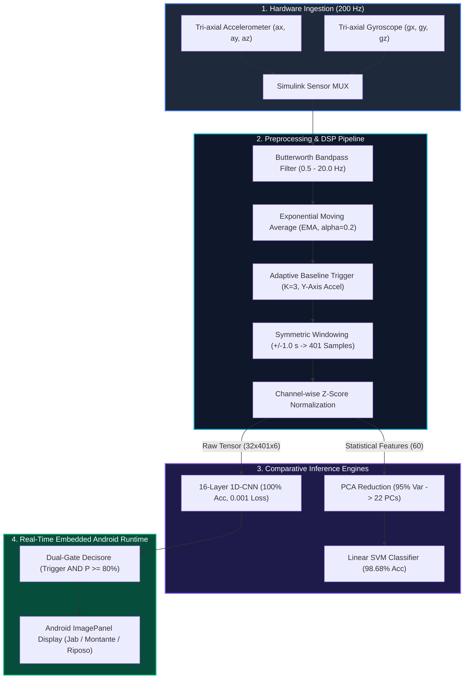
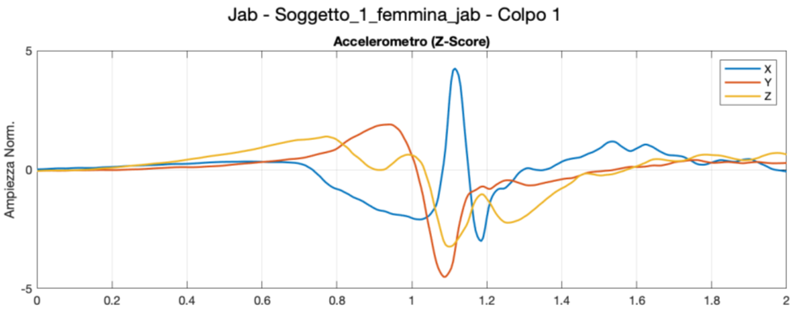
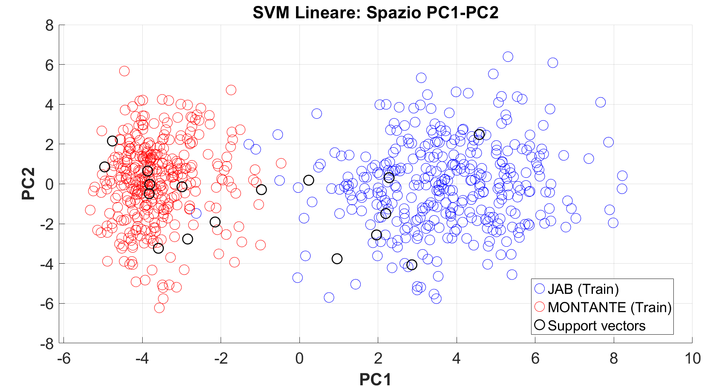
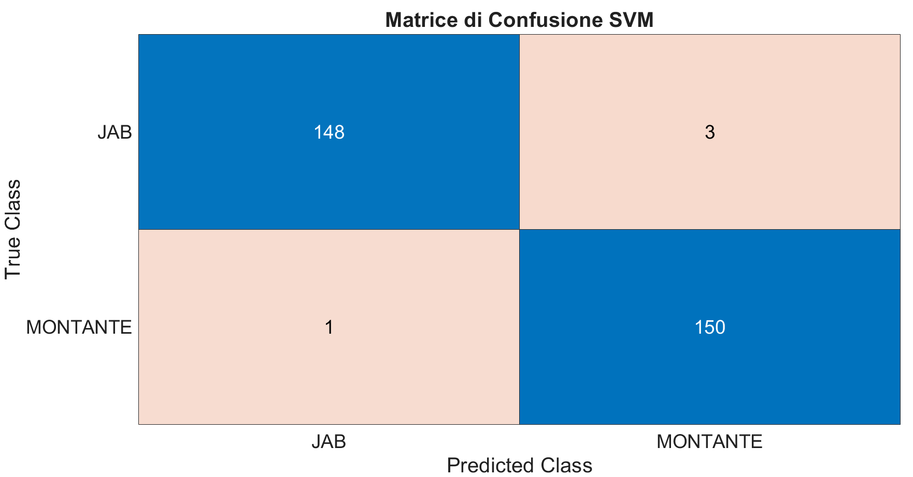
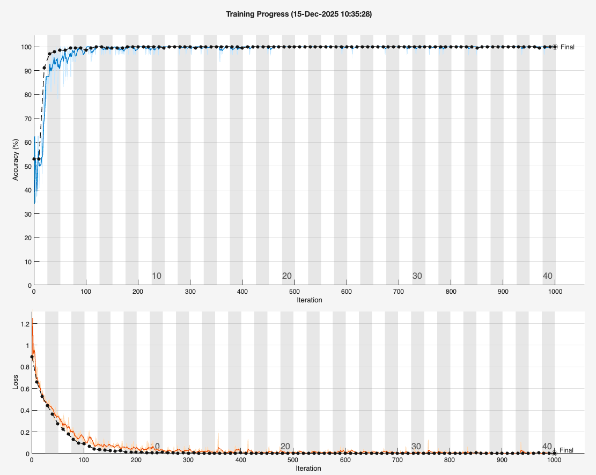
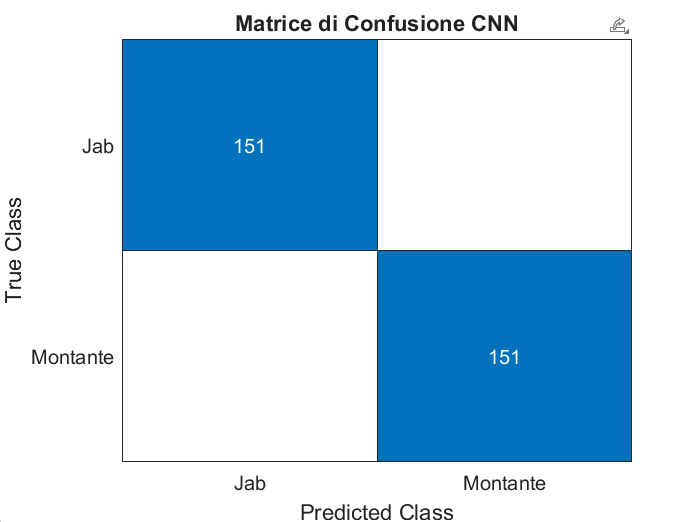
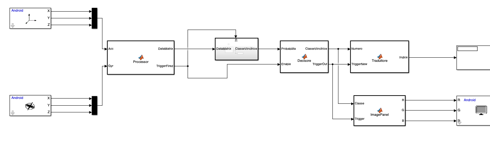
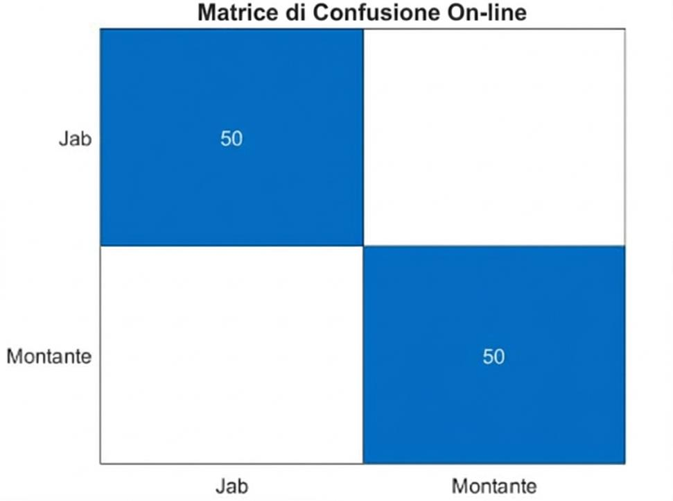

# Real-Time Embedded AI & Inertial Sensor Processing
### Human Activity Recognition (HAR) & Edge AI Punch Classification on Android via MATLAB/Simulink

[](https://www.mathworks.com/products/matlab.html)
[](https://www.mathworks.com/products/simulink.html)
[](https://www.mathworks.com/products/deep-learning.html)
[](https://www.mathworks.com/products/statistics.html)
[](#hardware--experimental-protocol)
[](#real-time-online-deployment-simulink--android)
[](#team--credits)

---

## Executive Summary

This repository hosts an end-to-end cyber-physical architecture and signal processing framework for **Human Activity Recognition (HAR)** and high-frequency athletic motion analytics. Developed in **MATLAB** and **Simulink**, the system captures raw 6-DOF inertial streaming data from a wrist-mounted smartphone at **200 Hz**, isolates ballistic combat sports movements (**Jab**, **Montante / Uppercut**, and **Riposo / Static Guard**), and performs instantaneous embedded classification with microsecond-level algorithmic latency.

The project features a rigorous comparative benchmark between:
1. **Classical Machine Learning Pipeline:** 60-feature statistical/spectral extraction + **Principal Component Analysis (PCA)** with 95% variance retention (reducing dimensionality to 22 components) + **Linear Support Vector Machine (SVM)** (**98.68% Accuracy**).
2. **End-to-End Deep Learning Architecture:** A custom **16-layer 1D Convolutional Neural Network (1D-CNN)** leveraging temporal convolutions, Batch Normalization, Max Pooling, and **Global Average Pooling (GAP)** (**100.00% Test Accuracy**, **Loss = 0.001**).

The optimal 1D-CNN network is compiled into a standalone **Simulink real-time state machine** and deployed directly onto mobile hardware via the *Simulink Support Package for Android Devices*, featuring a **Dual-Gate Safety Decisore** ($\text{Trigger} \land P_{\text{class}} \ge 0.80$) and instantaneous visual GUI feedback.

---

## System Architecture



---

## Hardware & Experimental Protocol

The data acquisition protocol was formulated to establish an experimentally robust, high-frequency biomechanical dataset of upper-limb ballistic actions.

<p align="center">
  
  <br>
  <em>Figure 1: Experimental setup illustrating the wrist-worn smartphone IMU placement during combat trial execution.</em>
</p>

### Acquisition Specifications:
* **Sensor Node:** Mobile device functioning as an integrated 6-DOF Inertial Measurement Unit (IMU).
* **Anatomical Placement:** Firmly anchored to the dorsal surface of the distal forearm/wrist of the dominant arm, ensuring minimal skin-sensor slippage during high-G impact decelerations.
* **Sampling Rate ($F_s$):** Synchronous hardware clock locked at **$200\text{ Hz}$** ($T_s = 5.0\text{ ms}$).
* **Cohort & Data Volume:** 10 diverse subjects (5 male, 5 female). Each subject completed 50 Jab and 50 Montante strikes:
  $$\text{Total Sample Volume} = 10 \times (50 + 50) = 1.000\text{ Validated Strikes}$$
* **Three-Phase Trial Cycle:**
  1. **Rest Baseline ($3.0\text{ s}$):** Static guard position (*Fermo*) to calibrate the subject's resting noise floor and sensor bias.
  2. **Ballistic Strike ($1.0\text{ s}$):** Rapid linear extension (*Jab*) or vertical angular scoop (*Montante*).
  3. **Recovery Phase ($2.0\text{ s}$):** Controlled deceleration and return to resting stance.

---

## Digital Signal Processing (DSP) & Segmentation Pipeline

Raw MEMS accelerometer and gyroscope data contain gravitational bias, baseline drift, and high-frequency muscular tremor. The offline and online DSP pipelines implement the following mathematical transformations:

<p align="center">
  
  <br>
  <em>Figure 2: Segmented and Z-Score normalized tri-axial accelerometer waveform during a Jab execution ($T = 401$ samples).</em>
</p>

### 1. Bandpass Filtering
A 4th-order digital Butterworth bandpass filter removes low-frequency postural sway and thermal drift below $0.5\text{ Hz}$, while eliminating motor tremor and sensor resonance above $20\text{ Hz}$:
$$H(z) = \frac{\sum_{k=0}^{M} b_k z^{-k}}{1 + \sum_{k=1}^{N} a_k z^{-k}}, \quad f_{\text{low}} = 0.5\text{ Hz}, \quad f_{\text{high}} = 20.0\text{ Hz}$$

### 2. Exponential Moving Average (EMA) Smoothing
To prevent spurious spikes from falsely triggering event segmentation, an EMA filter is applied to the dominant acceleration vector:
$$y[n] = \alpha \cdot x[n] + (1 - \alpha) \cdot y[n-1], \quad \alpha = 0.2$$

### 3. Adaptive Dynamic Thresholding & Windowing
* Kinematic analysis demonstrated that the **Y-axis accelerometer** provides the highest discriminative signal-to-noise ratio during punch launch.
* An initial $3.0\text{ s}$ warmup interval establishes the baseline noise standard deviation $\sigma_{\text{baseline}}$.
* The trigger fires when:
  $$\text{Acc}_Y[n] > \text{Threshold} = K \cdot \sigma_{\text{baseline}}, \quad K = 3.0$$
* A temporal circular buffer extracts a symmetric window of $\pm 1.0\text{ s}$ around the trigger peak:
  $$T = 2.0\text{ s} \times 200\text{ Hz} + 1 = 401\text{ samples}$$

### 4. Z-Score Standardization
Each isolated window is normalized channel-wise to zero mean and unit variance:
$$z_{c}[n] = \frac{x_{c}[n] - \mu_c}{\sigma_c}, \quad \forall c \in \{a_x, a_y, a_z, g_x, g_y, g_z\}$$

---

## Model 1: Feature Engineering, PCA & Linear SVM

For classical machine learning benchmarks, each $401 \times 6$ segmented window is projected into a dense statistical feature space.

### Extracted Feature Matrix (60 Dimensions)
For each of the 6 inertial axes, 10 mathematical metrics are extracted:
1. **Mean ($\mu$):** $\frac{1}{N} \sum x_i$
2. **Standard Deviation ($\sigma$):** $\sqrt{\frac{1}{N-1} \sum (x_i - \mu)^2}$
3. **Variance ($\sigma^2$):** $\frac{1}{N-1} \sum (x_i - \mu)^2$
4. **Skewness ($S$):** $\frac{\frac{1}{N} \sum (x_i - \mu)^3}{\sigma^3}$ (asymmetry of motion)
5. **Kurtosis ($K$):** $\frac{\frac{1}{N} \sum (x_i - \mu)^4}{\sigma^4}$ (peakedness of impact)
6. **Sum of Squares:** $\sum x_i^2$ (kinetic energy proxy)
7. **Root Mean Square (RMS):** $\sqrt{\frac{1}{N} \sum x_i^2}$
8. **Maximum Amplitude:** $\max(x)$
9. **Minimum Amplitude:** $\min(x)$
10. **Peak-to-Peak Range:** $\max(x) - \min(x)$

$$\text{Total Features} = 6\text{ channels} \times 10\text{ descriptors} = 60\text{ tabular features}$$

### Dimensionality Reduction via PCA
To eliminate collinearity across the 60 features and enable low-power embedded inference, Principal Component Analysis (PCA) was fitted on the 70% training split:
$$\mathbf{C} = \frac{1}{N-1} \mathbf{Z}^T \mathbf{Z} = \mathbf{V} \mathbf{\Lambda} \mathbf{V}^T$$
By retaining the components satisfying the $95\%$ cumulative explained variance criterion ($\sum_{i=1}^k \lambda_i / \sum \lambda \ge 0.95$), the feature space was compressed from **60 down to 22 orthogonal principal components** (**63.3% dimensionality reduction**).

<p align="center">
  
  <br>
  <em>Figure 3: Linear SVM decision projection in the first two principal components (PC1 vs PC2) with support vectors highlighted.</em>
</p>

### Linear SVM Classification Results
Trained on 70% ($N_{\text{train}} = 700$) and evaluated on a strictly held-out 30% test set ($N_{\text{test}} = 302$):
* **Accuracy:** **98.68%**
* **Precision:** **0.9804**
* **Recall:** **0.9934**
* **F1-Score:** **0.9868**
* **Classification Loss:** **0.0132**

<p align="center">
  
  <br>
  <em>Figure 4: Confusion matrix for the PCA-SVM classifier on the 302-trial test set (148/151 Jab, 150/151 Montante).</em>
</p>

---

## Model 2: 1D-Convolutional Neural Network (1D-CNN)

To eliminate the latency and hand-tuning of manual feature engineering, an end-to-end 1D-CNN was designed to ingest the raw multi-channel temporal tensor directly.

### Network Architecture (16 Layers)

| # | Layer Type | Activations / Output Shape | Parameters & Hyperparameters |
|---|---|---|---|
| 1 | **Sequence Input** | $6(C) \times 1(B) \times 401(T)$ | Tri-axial Acc + Tri-axial Gyro |
| 2 | **1-D Convolution (Conv1)** | $16(C) \times 1(B) \times 401(T)$ | 16 filters, Kernel Size 5, Padding 'same' |
| 3 | **Batch Normalization** | $16(C) \times 1(B) \times 401(T)$ | Mini-batch normalization |
| 4 | **ReLU Activation** | $16(C) \times 1(B) \times 401(T)$ | $f(x) = \max(0, x)$ non-linearity |
| 5 | **1-D Max Pooling** | $16(C) \times 1(B) \times 200(T)$ | Pool Size 2, Stride 2 (downsampling) |
| 6 | **1-D Convolution (Conv2)** | $32(C) \times 1(B) \times 200(T)$ | 32 filters, Kernel Size 3, Padding 'same' |
| 7 | **Batch Normalization** | $32(C) \times 1(B) \times 200(T)$ | Channel re-centering |
| 8 | **ReLU Activation** | $32(C) \times 1(B) \times 200(T)$ | Non-linear feature mapping |
| 9 | **1-D Max Pooling** | $32(C) \times 1(B) \times 100(T)$ | Pool Size 2, Stride 2 |
| 10 | **Global Average Pooling (GAP)** | $32(C) \times 1(B)$ | Collapses temporal dimension; prevents overfitting |
| 11 | **Fully Connected (Dense 1)** | $32(C) \times 1(B)$ | Dense linear transform |
| 12 | **ReLU Activation** | $32(C) \times 1(B)$ | Feature refinement |
| 13 | **Dropout** | $32(C) \times 1(B)$ | Dropout Probability $p = 0.5$ |
| 14 | **Fully Connected (Dense 2)** | $2(C) \times 1(B)$ | Logits for Jab vs Montante |
| 15 | **Softmax** | $2(C) \times 1(B)$ | Categorical probability distribution |
| 16 | **Classification Output** | Output Class | Cross-Entropy Loss |

### Training Dynamics & Optimization
* **Optimization Algorithm:** Adam (Adaptive Moment Estimation)
* **Initial Learning Rate:** $1 \times 10^{-3}$
* **Mini-Batch Size:** 32 samples
* **Epochs:** 40 epochs with full dataset reshuffling every epoch
* **Loss Function:** Categorical Cross-Entropy

<p align="center">
  
  <br>
  <em>Figure 5: Training progress over 40 epochs (1,000 iterations), showing rapid convergence to 100% accuracy and loss < 0.001.</em>
</p>

### Test Set Performance
Tested on an independent hold-out test set of 302 trials ($151\text{ Jab}, 151\text{ Montante}$):
* **Accuracy:** **100.00%**
* **Precision:** **100.00%**
* **Recall:** **100.00%**
* **F1-Score:** **100.00%**
* **Loss:** **0.0010**

<p align="center">
  
  <br>
  <em>Figure 6: Test set confusion matrix of the 1D-CNN showing zero misclassifications (151/151 Jab, 151/151 Montante).</em>
</p>

---

## Comparative Model Benchmark

| Performance Metric | PCA + Linear SVM | 1D-CNN (Proposed) | Relative Improvement |
|---|---|---|---|
| **Input Data Format** | 60 Tabular Features | $401 \times 6$ Raw Time Series | No manual feature engineering |
| **Dimensionality** | 22 Principal Components | 32 GAP Latent Features | Automated deep representation |
| **Test Accuracy** | **98.68%** | **100.00%** | **+1.32% (Zero Errors)** |
| **Precision** | 0.9804 | **1.0000** | +1.96% |
| **Recall (Sensitivity)** | 0.9934 | **1.0000** | +0.66% |
| **F1-Score** | 0.9868 | **1.0000** | +1.32% |
| **Test Loss** | 0.0132 | **0.0010** | **-92.4% Loss Reduction** |
| **Execution Paradigm** | Pre-computed batch features | Event-triggered neural tensor | Real-time streamable |

---

## Real-Time Online Deployment (Simulink + Android)

The compiled 1D-CNN network (`Rete_CNN_Finale.mat`) is integrated into a synchronous real-time execution engine in **Simulink** (`test_online.slx`), configured for target deployment on Android hardware.

<p align="center">
  
  <br>
  <em>Figure 7: Complete Simulink real-time pipeline containing Android Sensor Ingestion, DSP Processor, Triggered 1D-CNN Subsystem, Decisore Gate, and ImagePanel Display.</em>
</p>

### Pipeline Execution Flow:
1. **Android Sensor Blocks:** Streams synchronous 3-axis acceleration and 3-axis angular velocity at $200\text{ Hz}$.
2. **`Processor` Block (MATLAB Function):** 
   - Manages an internal circular FIFO buffer of size $401 \times 6$.
   - Computes continuous baseline drift tracking and applies online EMA filtering.
   - Outputs the normalized `DataMatrix` ($401 \times 6$) and asserts `TriggerFired = 1` only upon impact detection.
3. **Triggered Neural Subsystem:**
   - The computationally demanding neural inference is encapsulated in a *Triggered Subsystem*.
   - During resting and guard states, the block remains idle ($0\text{ FLOPS}$ consumed), activating exclusively when `TriggerFired` goes high.
4. **`Decisore` Block (Dual-Gate Safety Logic):**
   - Validates class prediction only if:
     $$\text{TriggerOut} = \text{TriggerFired} \land \max(P_{\text{Jab}}, P_{\text{Montante}}) \ge 0.80$$
   - Prevents false triggers caused by non-ballistic arm repositioning, glove adjustments, or casual gestures.
5. **`Traduttore` & `ImagePanel` Block:**
   - Maps the confirmed integer class (`0 = Riposo`, `1 = Jab`, `2 = Montante`) to the corresponding visual asset (`Riposo_1.jpg`, `Jab_1.jpg`, `Montante_1.jpg`).
   - Renders the image matrix to the smartphone screen via the *Android Display* block with imperceptible latency.

<p align="center">
  
  <br>
  <em>Figure 8: Live on-device validation matrix demonstrating 100% punch classification fidelity across 100 consecutive real-time test strikes (50 Jab, 50 Montante).</em>
</p>

---

## Repository Structure

```
Real-Time-Embedded-AI-Inertial-Sensor-Processing/
├── ACQUISIZIONE/
│   ├── Acquisizione_dati.slx         # Simulink model for live Android sensor stream logging (200 Hz)
│   └── Estrazione_dati.m              # MATLAB script to inspect, plot, and partition raw sensor data
├── OFFLINE/
│   ├── Preprocessing.m               # Butterworth filtering, EMA, adaptive triggering, windowing
│   ├── Estrazione_features.m         # 60 statistical feature extraction across 6 channels
│   ├── PCA_SVM.m                     # PCA 95% variance reduction and Linear SVM training & evaluation
│   ├── CNN_1D.m                      # 16-layer 1D-CNN architecture, Adam optimization & benchmark
│   ├── Rete_CNN_Finale.mat           # Serialized trained 1D-CNN network object for Simulink
│   └── MATLAB_SVM_FEATURES/
│       └── Dataset_Finale_Features.mat # Pre-extracted 60-feature dataset (1,000 trials)
├── ONLINE/
│   ├── test_online.slx               # Complete real-time Simulink deployment model for Android
│   ├── dati.mat                      # Offline test verification workspace
│   ├── Rete_CNN_Finale.mat           # Deployment weights for the neural subsystem
│   ├── Jab_1.jpg                     # UI graphic for Jab recognition feedback
│   ├── Montante_1.jpg                # UI graphic for Montante recognition feedback
│   └── Riposo_1.jpg                  # UI graphic for neutral / resting stance
├── docs/
│   └── assets/                       # High-resolution architectural schematics and result plots
│       ├── setup_hardware_polso.png
│       ├── dsp_waveform_segmentation.png
│       ├── pca_feature_space_svm.png
│       ├── svm_confusion_matrix.png
│       ├── cnn_training_progress.png
│       ├── cnn_confusion_matrix.png
│       ├── simulink_realtime_pipeline.png
│       └── live_online_confusion_matrix.png
├── .gitignore                        # Git exclusion rules for OS and MATLAB cache
└── README.md                         # Publication-grade technical documentation
```

---

## Getting Started & Reproduction

### Prerequisites
* **MATLAB & Simulink:** R2022b or later (R2024b+ recommended)
* **Required Toolboxes:**
  * Deep Learning Toolbox
  * Statistics and Machine Learning Toolbox
  * Signal Processing Toolbox
  * Simulink Support Package for Android Devices

### 1. Offline Signal Preprocessing & Feature Extraction
```matlab
% In MATLAB command prompt:
cd('OFFLINE');
Preprocessing;          % Applies 0.5-20Hz Butterworth, EMA, adaptive windowing
Estrazione_features;    % Computes 60 statistical descriptors per strike
```

### 2. Model Training & Evaluation
```matlab
% Train Classical PCA-SVM Model:
PCA_SVM;

% Train End-to-End Deep 1D-CNN:
CNN_1D;                 % Saves optimized model to Rete_CNN_Finale.mat
```

### 3. Real-Time Online Android Inference
1. Connect an Android smartphone via USB with **USB Debugging** enabled.
2. In MATLAB, navigate to `ONLINE/`:
   ```matlab
   cd('../ONLINE');
   open('test_online.slx');
   ```
3. In Simulink, select **Hardware tab > Build, Deploy & Start** to deploy directly to the target smartphone.
4. Mount the device to the wrist and perform test strikes: the screen will instantaneously display the detected punch type.

---

## Academic References

1. **Worsey, M. T. O., Espinosa, H. G., Shepherd, J. B., & Thiel, D. V. (2020).** *An Evaluation of Wearable Inertial Sensor Configuration and Supervised Machine Learning Models for Automatic Punch Classification in Boxing.* IoT, 1(2), 21. DOI: [10.3390/iot1020021](https://doi.org/10.3390/iot1020021)
2. **Manoharan, S., Warburton, J., Hegde, R. S., Srinivasan, R., & Srinivasan, B. (2025).** *An active machine learning framework for automatic boxing punch recognition and classification using upper limb kinematics.* PLOS ONE, 20(3), e0322490. DOI: [10.1371/journal.pone.0322490](https://doi.org/10.1371/journal.pone.0322490)
3. **Giraud, T., et al. (2021).** *Improving Human Activity Recognition Through 1D-ResNet: A Wearable Wristband for 14 Workout Movements.* MDPI Sensors.
4. **Al-Kharji, M., et al. (2023).** *IMU-Based Fitness Activity Recognition Using Convolutional Neural Networks for Time Series Classification.* NIH / PubMed Central.

---

## Team & Credits

This project was engineered as part of the **Automazione e Sicurezza di Ambienti di Lavoro** Master's curriculum (A.Y. 2025/2026) by **Gruppo 6**:
* **Alessandro Ronan Reinoso Dominguez**
* **Marta Nuzzo**
* **Chiara Ciancarella**
* **Gian Lorenzo Vignati**

---
*For questions or collaborations regarding embedded biomechanical signal processing and real-time HAR edge AI, please visit [ronanreinoso.dev](https://porfolio-rard.web.app).*
