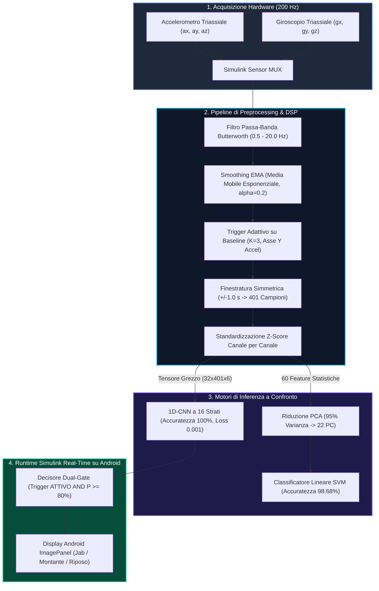

# Real-Time Embedded AI & Inertial Sensor Processing
### Human Activity Recognition (HAR) & Classificazione Pugilistica Edge AI su Android tramite MATLAB / Simulink

[](https://www.mathworks.com/products/matlab.html)
[](https://www.mathworks.com/products/simulink.html)
[](https://www.mathworks.com/products/deep-learning.html)
[](https://www.mathworks.com/products/statistics.html)
[](#hardware-e-protocollo-sperimentale)
[](#deployment-real-time-online-simulink--android)
[](#team--crediti)

---

## Sommario Esecutivo

Questo repository racchiude l'architettura cyber-fisica e il framework di elaborazione dei segnali per il **Riconoscimento delle Attività Umane (HAR)** e l'analisi quantitativa dei gesti atletici ad alta frequenza. Sviluppato interamente in ambiente **MATLAB** e **Simulink**, il sistema acquisisce lo streaming inerziale grezzo 6-DOF da uno smartphone fissato al polso alla frequenza di **200 Hz**, isola e segmenta i movimenti balistici del pugilato (**Jab**, **Montante / Uppercut** e stato di **Riposo / Guardia Statica**), ed esegue una classificazione istantanea con latenza computazionale deterministica e impercettibile.

Il progetto include un benchmark rigoroso tra due paradigmi modellistici:
1. **Pipeline di Machine Learning Classico:** Estrazione tabulare di 60 feature statistiche/spettrali + Riduzione della dimensionalità tramite **Principal Component Analysis (PCA)** al 95% di varianza spiegata (da 60 a 22 componenti) + Classificatore **Support Vector Machine (SVM)** a kernel lineare (**Accuratezza 98.68%**).
2. **Architettura di Deep Learning End-to-End:** Una rete **Convolutional Neural Network 1D (1D-CNN)** personalizzata a 16 strati, basata su convoluzioni temporali, Batch Normalization, Max Pooling e **Global Average Pooling (GAP)** (**Accuratezza 100.00% sul Test Set**, **Loss = 0.001**).

La rete neurale ottimale è integrata in un runtime **Simulink real-time** per il deployment diretto su smartphone tramite il *Simulink Support Package for Android Devices*, equipaggiata con un blocco **Decisore a Doppia Soglia di Sicurezza** ($\text{Trigger} \land P_{\text{classe}} \ge 0.80$) e feedback visivo istantaneo su display.

---

## Architettura di Sistema



---

## Hardware e Protocollo Sperimentale

Il protocollo di acquisizione è stato studiato per garantire la massima riproducibilità scientifica e l'affidabilità dei segnali biomeccanici degli arti superiori.

<p align="center">
  
  <br>
  <em>Figura 1: Setup sperimentale con smartphone posizionato al polso dell'atleta durante le prove dinamiche.</em>
</p>

### Specifiche dell'Acquisizione:
* **Dispositivo Sensoriale:** Smartphone commerciale utilizzato come Unità di Misura Inerziale (IMU) 6-DOF.
* **Posizionamento Anatomico:** Fissaggio rigido alla superficie dorsale del polso/avambraccio distale del braccio dominante, minimizzando artefatti da scivolamento cutaneo durante le decelerazioni d'impatto ad alto numero di G.
* **Frequenza di Campionamento ($F_s$):** Clock hardware sincrono bloccato a **$200\text{ Hz}$** ($T_s = 5.0\text{ ms}$).
* **Campione & Volume Dati:** 10 soggetti (5 maschi, 5 femmine). Ciascun partecipante ha eseguito 50 Jab e 50 Montanti:

$$
\text{Dataset Complessivo} = 10 \times (50 + 50) = 1.000\text{ Colpi Validati}
$$

* **Ciclo Temporale del Protocollo:**
  1. **Riposo Iniziale ($3.0\text{ s}$):** Posizione di guardia statica (*Fermo*) per la taratura della baseline di rumore e degli offset dei sensori.
  2. **Azione Balistica ($1.0\text{ s}$):** Estensione lineare rapida (*Jab*) o traiettoria circolare ascendente (*Montante*).
  3. **Fase di Recupero ($2.0\text{ s}$):** Decelerazione controllata e ritorno alla postura di guardia.

---

## Pipeline di Elaborazione Segnali Digitali (DSP) e Segmentazione

I segnali grezzi degli accelerometri e giroscopi MEMS presentano bias gravitazionale, derive termiche a bassa frequenza e rumore muscolare ad alta frequenza. La pipeline implementa la seguente catena di trasformazioni:

<p align="center">
  
  <br>
  <em>Figura 2: Forma d'onda triassiale dell'accelerometro (normalizzata Z-Score) durante l'esecuzione di un Jab ($T = 401$ campioni).</em>
</p>

### 1. Filtraggio Passa-Banda
Un filtro digitale IIR Butterworth di 4° ordine rimuove le oscillazioni posturali al di sotto di $0.5\text{ Hz}$ e sopprime il tremore e il rumore elettronico al di sopra di $20\text{ Hz}$:

$$
H(z) = \frac{\sum_{k=0}^{M} b_k z^{-k}}{1 + \sum_{k=1}^{N} a_k z^{-k}}, \qquad f_{\text{low}} = 0.5\text{ Hz}, \quad f_{\text{high}} = 20.0\text{ Hz}
$$

### 2. Smoothing tramite Media Mobile Esponenziale (EMA)
Per evitare falsi allarmi nella fase di triggering, viene applicato un filtro EMA sulla componente cinematica dominante:

$$
y[n] = \alpha \cdot x[n] + (1 - \alpha) \cdot y[n-1], \qquad \alpha = 0.2
$$

### 3. Soglia Dinamica Adattiva & Finestratura
* L'analisi cinematica ha identificato l'**asse Y dell'accelerometro** come la componente con il più alto rapporto segnale-rumore discriminante.
* L'intervallo di warmup iniziale ($3.0\text{ s}$) calcola la deviazione standard della baseline a riposo $\sigma_{\text{baseline}}$.
* Il trigger scatta quando:

$$
\text{Acc}_Y[n] > \text{Soglia} = K \cdot \sigma_{\text{baseline}}, \qquad K = 3.0
$$

* Un buffer circolare estrae una finestra temporale simmetrica di $\pm 1.0\text{ s}$ attorno al picco del colpo:

$$
T = 2.0\text{ s} \times 200\text{ Hz} + 1 = 401\text{ campioni}
$$

### 4. Standardizzazione Z-Score
Ciascuna finestra estratta viene normalizzata canale per canale a media nulla e varianza unitaria:

$$
z_{c}[n] = \frac{x_{c}[n] - \mu_c}{\sigma_c}, \qquad \forall c \in \{a_x, a_y, a_z, g_x, g_y, g_z\}
$$

---

## Modello 1: Feature Engineering, PCA e SVM Lineare

Per la sperimentazione con Machine Learning tradizionale, ogni finestra $401 \times 6$ viene proiettata in uno spazio tabulare di caratteristiche descrittive.

### Matrice delle Feature (60 Dimensioni)
Per ciascuno dei 6 assi inerziali vengono estratte 10 metriche statistiche e morfologiche:
1. **Media ($\mu$):** $\frac{1}{N} \sum x_i$
2. **Deviazione Standard ($\sigma$):** $\sqrt{\frac{1}{N-1} \sum (x_i - \mu)^2}$
3. **Varianza ($\sigma^2$):** $\frac{1}{N-1} \sum (x_i - \mu)^2$
4. **Asimmetria (Skewness, $S$):** $\frac{\frac{1}{N} \sum (x_i - \mu)^3}{\sigma^3}$ (asimmetria del movimento)
5. **Curtosi ($K$):** $\frac{\frac{1}{N} \sum (x_i - \mu)^4}{\sigma^4}$ (ripidità e impulsività del picco)
6. **Somma dei Quadrati:** $\sum x_i^2$ (proxi dell'energia cinetica)
7. **Valore Efficace (RMS):** $\sqrt{\frac{1}{N} \sum x_i^2}$
8. **Valore Massimo:** $\max(x)$
9. **Valore Minimo:** $\min(x)$
10. **Intervallo (Range):** $\max(x) - \min(x)$

$$
\text{Totale Feature} = 6\text{ canali} \times 10\text{ descrittori} = 60\text{ feature per prova}
$$

### Riduzione della Dimensionalità con PCA
Per eliminare la multicollinearità e consentire l'inferenza embedded a bassissimo assorbimento computazionale, è stata calcolata la PCA sul set di addestramento (70%):

$$
\mathbf{C} = \frac{1}{N-1} \mathbf{Z}^T \mathbf{Z} = \mathbf{V} \mathbf{\Lambda} \mathbf{V}^T
$$
Impostando come criterio la soglia di **varianza cumulativa spiegata al 95%** ($\sum_{i=1}^k \lambda_i / \sum \lambda \ge 0.95$), lo spazio è stato compresso da **60 feature a sole 22 componenti principali** (**abbattimento del 63.3% della dimensionalità**).

<p align="center">
  
  <br>
  <em>Figura 3: Proiezione della decisione SVM nelle prime due componenti principali (PC1 vs PC2) con evidenza dei vettori di supporto.</em>
</p>

### Risultati del Classificatore SVM Lineare
Addestrato sul 70% ($N_{\text{train}} = 700$) e validato su un test set indipendente del 30% ($N_{\text{test}} = 302$):
* **Accuratezza (Accuracy):** **98.68%**
* **Precisione (Precision):** **0.9804**
* **Richiamo (Recall):** **0.9934**
* **F1-Score:** **0.9868**
* **Loss di Classificazione:** **0.0132**

<p align="center">
  
  <br>
  <em>Figura 4: Matrice di confusione del classificatore PCA-SVM sul test set di 302 prove (148/151 Jab corretti, 150/151 Montanti corretti).</em>
</p>

---

## Modello 2: Rete Neurale Convoluzionale 1D (1D-CNN)

Per superare i limiti del feature engineering manuale, è stata progettata una rete deep 1D-CNN operante direttamente sul tensore temporale multicanale grezzo.

### Architettura Dettagliata (16 Strati)

| # | Tipologia di Strato | Dimensioni / Tensore di Uscita | Dettagli & Iperparametri |
|---|---|---|---|
| 1 | **Sequence Input** | $6(C) \times 1(B) \times 401(T)$ | Segnali sincroni Acc 3D + Giro 3D |
| 2 | **Convoluzione 1D (Conv1)** | $16(C) \times 1(B) \times 401(T)$ | 16 filtri, Kernel Size 5, Padding 'same' |
| 3 | **Batch Normalization** | $16(C) \times 1(B) \times 401(T)$ | Normalizzazione del mini-batch |
| 4 | **Attivazione ReLU** | $16(C) \times 1(B) \times 401(T)$ | Non-linearità $f(x) = \max(0, x)$ |
| 5 | **1D Max Pooling** | $16(C) \times 1(B) \times 200(T)$ | Pool Size 2, Stride 2 (dimezzamento temporale) |
| 6 | **Convoluzione 1D (Conv2)** | $32(C) \times 1(B) \times 200(T)$ | 32 filtri, Kernel Size 3, Padding 'same' |
| 7 | **Batch Normalization** | $32(C) \times 1(B) \times 200(T)$ | Ri-centraggio canali |
| 8 | **Attivazione ReLU** | $32(C) \times 1(B) \times 200(T)$ | Estrazione pattern cinematici complessi |
| 9 | **1D Max Pooling** | $32(C) \times 1(B) \times 100(T)$ | Pool Size 2, Stride 2 |
| 10 | **Global Average Pooling (GAP)** | $32(C) \times 1(B)$ | Comprime il tempo in 32 feature; azzera l'overfitting |
| 11 | **Fully Connected (Dense 1)** | $32(C) \times 1(B)$ | Trasformazione lineare densa |
| 12 | **Attivazione ReLU** | $32(C) \times 1(B)$ | Raffinamento delle feature latenti |
| 13 | **Dropout** | $32(C) \times 1(B)$ | Probabilità di spegnimento $p = 0.5$ |
| 14 | **Fully Connected (Dense 2)** | $2(C) \times 1(B)$ | Logit per Jab vs Montante |
| 15 | **Softmax** | $2(C) \times 1(B)$ | Distribuzione di probabilità categoriale |
| 16 | **Classification Output** | Classe Stimata | Cross-Entropy Loss |

### Dinamica di Addestramento e Ottimizzazione
* **Algoritmo di Ottimizzazione:** Adam (Adaptive Moment Estimation)
* **Learning Rate Iniziale:** $1 \times 10^{-3}$
* **Mini-Batch Size:** 32 campioni
* **Epoche:** 40 epoche con rimescolamento casuale (*shuffling*) ad ogni iterazione
* **Funzione di Costo:** Cross-Entropy Categoriale

<p align="center">
  
  <br>
  <em>Figura 5: Curve di apprendimento lungo 40 epoche (1.000 iterazioni): convergenza rapida al 100% di accuratezza e loss pari a 0.001.</em>
</p>

### Prestazioni sul Test Set
Validato sul test set indipendente di 302 prove ($151\text{ Jab}, 151\text{ Montanti}$):
* **Accuratezza (Accuracy):** **100.00%**
* **Precisione (Precision):** **100.00%**
* **Richiamo (Recall):** **100.00%**
* **F1-Score:** **100.00%**
* **Loss:** **0.0010**

<p align="center">
  
  <br>
  <em>Figura 6: Matrice di confusione della rete 1D-CNN: zero errori di classificazione (151/151 Jab, 151/151 Montante).</em>
</p>

---

## Benchmark Comparativo dei Modelli

| Metrica di Performance | PCA + SVM Lineare | 1D-CNN (Proposta) | Miglioramento Relativo |
|---|---|---|---|
| **Formato Input** | 60 Feature Tabulari | Tensore Grezzo $401 \times 6$ | Zero feature engineering manuale |
| **Dimensionalità** | 22 Componenti Principali | 32 Feature Latenti GAP | Rappresentazione deep automatica |
| **Accuratezza (Accuracy)** | **98.68%** | **100.00%** | **+1.32% (Zero Errori)** |
| **Precisione (Precision)** | 0.9804 | **1.0000** | +1.96% |
| **Richiamo (Recall)** | 0.9934 | **1.0000** | +0.66% |
| **F1-Score** | 0.9868 | **1.0000** | +1.32% |
| **Loss sul Test Set** | 0.0132 | **0.0010** | **-92.4% Riduzione Errore** |
| **Paradigma di Esecuzione** | Calcolo feature in batch | Tensore neurale su evento | Ottimizzato per streaming real-time |

---

## Deployment Real-Time Online (Simulink + Android)

La rete 1D-CNN addestrata (`Rete_CNN_Finale.mat`) è integrata in un runtime real-time in **Simulink** (`test_online.slx`), configurato per l'esecuzione diretta su hardware Android.

<p align="center">
  
  <br>
  <em>Figura 7: Schema a blocchi Simulink completo: Acquisizione Sensori Android, Blocco Processor DSP, Subsystem Neurale Triggerato, Decisore e ImagePanel Display.</em>
</p>

### Flusso di Esecuzione Runtime:
1. **Blocchi Sensori Android:** Streaming sincrono a $200\text{ Hz}$ dei dati di accelerometro e giroscopio.
2. **Blocco `Processor` (MATLAB Function):** 
   - Gestisce internamente un buffer circolare FIFO da $401 \times 6$ campioni.
   - Applica lo smoothing EMA in tempo reale e traccia la baseline a riposo.
   - Genera in uscita la matrice normalizzata `DataMatrix` ($401 \times 6$) e attiva `TriggerFired = 1` solo al superamento della soglia d'impatto.
3. **Subsystem Neurale Triggerato:**
   - L'inferenza computazionale della CNN è incapsulata all'interno di un *Triggered Subsystem*.
   - A riposo e in guardia, il blocco rimane spento ($0\text{ FLOPS}$ consumati), salvaguardando la batteria dello smartphone e attivandosi esclusivamente all'evento trigger.
4. **Blocco `Decisore` (Dual-Gate Safety Logic):**
   - Convalida la classe predetta esclusivamente se:


\text{TriggerOut} = \text{TriggerFired} \land \max(P_{\text{Jab}}, P_{\text{Montante}}) \ge 0.80


   - Filtra i falsi positivi generati da movimenti involontari, riposizionamento dei guantoni o gestualità quotidiana.
5. **Blocchi `Traduttore` & `ImagePanel`:**
   - Mappa l'indice numerico confermato (`0 = Riposo`, `1 = Jab`, `2 = Montante`) all'immagine visiva corrispondente (`Riposo_1.jpg`, `Jab_1.jpg`, `Montante_1.jpg`).
   - Esegue il rendering istantaneo sul display del telefono con latenza impercettibile.

<p align="center">
  
  <br>
  <em>Figura 8: Matrice di validazione online on-device: 100% di accuratezza su 100 colpi consecutivi eseguiti dal vivo (50 Jab, 50 Montante).</em>
</p>

---

## Struttura del Repository

```
Real-Time-Embedded-AI-Inertial-Sensor-Processing/
├── ACQUISIZIONE/
│   ├── Acquisizione_dati.slx         # Modello Simulink per la registrazione streaming da Android (200 Hz)
│   └── Estrazione_dati.m              # Script MATLAB per ispezione, plot e salvataggio delle prove
├── OFFLINE/
│   ├── Preprocessing.m               # Filtraggio Butterworth, EMA, trigger dinamico e finestratura
│   ├── Estrazione_features.m         # Estrazione di 60 descrittori statistici su 6 canali
│   ├── PCA_SVM.m                     # Riduzione PCA 95% varianza e training del classificatore SVM
│   ├── CNN_1D.m                      # Architettura 1D-CNN a 16 strati, ottimizzazione Adam e benchmark
│   ├── Rete_CNN_Finale.mat           # Modello neurale serializzato pronto per Simulink
│   └── MATLAB_SVM_FEATURES/
│       └── Dataset_Finale_Features.mat # Dataset tabulare pre-estratto (1.000 prove)
├── ONLINE/
│   ├── test_online.slx               # Modello Simulink completo per inferenza real-time su Android
│   ├── dati.mat                      # Workspace di test offline per verifica logica
│   ├── Rete_CNN_Finale.mat           # Pesi neurali caricati nel subsystem di inferenza
│   ├── Jab_1.jpg                     # Grafica UI per feedback visivo Jab
│   ├── Montante_1.jpg                # Grafica UI per feedback visivo Montante
│   └── Riposo_1.jpg                  # Grafica UI per postura di guardia/riposo
├── docs/
│   └── assets/                       # Figure e schemi architetturali ad alta risoluzione
│       ├── setup_hardware_polso.png
│       ├── dsp_waveform_segmentation.png
│       ├── pca_feature_space_svm.png
│       ├── svm_confusion_matrix.png
│       ├── cnn_training_progress.png
│       ├── cnn_confusion_matrix.png
│       ├── simulink_realtime_pipeline.png
│       └── live_online_confusion_matrix.png
├── .gitignore                        # Regole di esclusione per cache MATLAB e file di sistema
└── README.md                         # Documentazione tecnica scientifica
```

---

## Guida all'Avvio e Riproducibilità

### Prerequisiti Software
* **MATLAB & Simulink:** Versione R2022b o superiore (consigliata R2024b o successiva)
* **Toolbox Richiesti:**
  * Deep Learning Toolbox
  * Statistics and Machine Learning Toolbox
  * Signal Processing Toolbox
  * Simulink Support Package for Android Devices

### 1. Preprocessing dei Segnali & Estrazione Feature (Offline)
```matlab
% Dalla riga di comando di MATLAB:
cd('OFFLINE');
Preprocessing;          % Applica Butterworth 0.5-20Hz, EMA e finestratura
Estrazione_features;    % Calcola i 60 descrittori statistici per ogni colpo
```

### 2. Addestramento e Valutazione dei Modelli
```matlab
% Addestramento Modello Classico PCA-SVM:
PCA_SVM;

% Addestramento Rete Neurale Deep 1D-CNN:
CNN_1D;                 % Salva il modello ottimizzato in Rete_CNN_Finale.mat
```

### 3. Esecuzione Real-Time in Simulink su Android
1. Connettere lo smartphone Android via cavo USB abilitando il **Debug USB**.
2. In MATLAB, posizionarsi nella cartella `ONLINE/`:
   ```matlab
   cd('../ONLINE');
   open('test_online.slx');
   ```
3. In Simulink, selezionare la scheda **Hardware > Build, Deploy & Start** per compilare ed eseguire il modello direttamente sullo smartphone.
4. Fissare il dispositivo al polso ed eseguire i movimenti pugilistici: lo schermo mostrerà in tempo reale l'illustrazione del colpo riconosciuto con probabilità superiore all'80%.

---

## Riferimenti Bibliografici

1. **Worsey, M. T. O., Espinosa, H. G., Shepherd, J. B., & Thiel, D. V. (2020).** *An Evaluation of Wearable Inertial Sensor Configuration and Supervised Machine Learning Models for Automatic Punch Classification in Boxing.* IoT, 1(2), 21. DOI: [10.3390/iot1020021](https://doi.org/10.3390/iot1020021)
2. **Manoharan, S., Warburton, J., Hegde, R. S., Srinivasan, R., & Srinivasan, B. (2025).** *An active machine learning framework for automatic boxing punch recognition and classification using upper limb kinematics.* PLOS ONE, 20(3), e0322490. DOI: [10.1371/journal.pone.0322490](https://doi.org/10.1371/journal.pone.0322490)
3. **Giraud, T., et al. (2021).** *Improving Human Activity Recognition Through 1D-ResNet: A Wearable Wristband for 14 Workout Movements.* MDPI Sensors.
4. **Al-Kharji, M., et al. (2023).** *IMU-Based Fitness Activity Recognition Using Convolutional Neural Networks for Time Series Classification.* NIH / PubMed Central.

---

## Team & Crediti

Progetto realizzato nell'ambito del corso magistrale di **Automazione e Sicurezza di Ambienti di Lavoro** (A.A. 2025/2026) dal **Gruppo 6**:
* **Alessandro Ronan Reinoso Dominguez**
* **Marta Nuzzo**
* **Chiara Ciancarella**
* **Gian Lorenzo Vignati**

---
*Per informazioni, chiarimenti o collaborazioni sull'elaborazione di segnali biomeccanici e l'Edge AI per sistemi embedded, visita [ronanreinoso.dev](https://porfolio-rard.web.app).*
